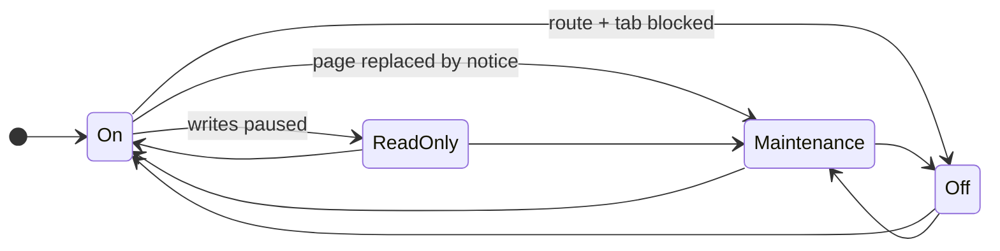
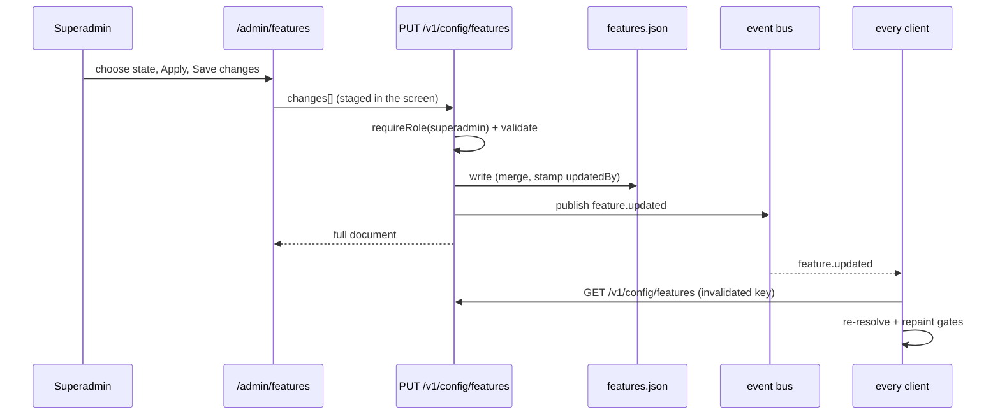

# Remote feature control

One switchboard for the whole app. A superadmin can put any surface into
**maintenance**, make it **read only**, or switch it **off** — globally, from the
server, without shipping a build.

It exists for one job: **contain a broken page fast**. A feature that is throwing
is worse than a feature that is missing, so the answer is a switch, not a hotfix
at 2 a.m.

```
/ admin / features          ← superadmin console (in the app)
GET  /v1/config/features    ← public read (must work before sign-in)
PUT  /v1/config/features    ← superadmin write
server/data/documents/config/features.json   ← the document itself
```

---

## 1. The ladder

Every feature has exactly one state. The states are ordered; the app never
invents a fifth.

| State         | Rank | Page                           | Navigation               | Writes                 | Reads |
| ------------- | ---- | ------------------------------ | ------------------------ | ---------------------- | ----- |
| `on`          | 0    | renders                        | tab shown                | allowed                | yes   |
| `read-only`   | 1    | renders, write controls hidden | tab shown                | refused (client + 503) | yes   |
| `maintenance` | 2    | replaced by a notice           | tab shown, page blocked  | refused (503)          | yes   |
| `off`         | 3    | replaced by a notice           | tab hidden, page blocked | refused (503)          | yes   |

Two deliberate choices:

- **Maintenance keeps the tab.** People need to know the page exists and is
  coming back; a vanished tab reads as a product decision.
- **`off` hides the tab on native** (`NativeTabs.Trigger hidden`, which also
  makes the route unreachable) and from the web bar, but the route gate is what
  actually blocks a deep link.

`read-only` only means something where there is a write. On a surface with no
writes it behaves like `on` — the console still lets you choose it, and the
documented table below says what it does per surface.

---

## 2. Granularity: the key _is_ the hierarchy

Four levels, in this order:

```
app                     the whole app
└── area                a tab or a domain (quran, meetings, admin)
    └── page            a route (/quran/records, /account/edit)
        └── capability  an action inside a page (meetings.create)
```

A feature is a **dotted key**. The dots are the inheritance chain, and nothing
else stores a parent:

```
meetings.create  →  ['app', 'meetings', 'meetings.create']
admin.members.edit → ['app', 'admin', 'admin.members', 'admin.members.edit']
```

**The most restrictive rung on the chain wins.** A child can be stricter than
its parent, never looser. So `meetings: off` closes `meetings.create` even if
`meetings.create` says `on`, and the console shows _why_ ("Restricted by
Meetings").

The same rule is implemented twice — `src/features/flags/registry.ts` (client)
and `server/features.ts` (server). Neither imports the other; both derive the
chain from the string, so they cannot drift.

### Exemptions

An override may list roles that are **not affected by that node**:

```json
{ "state": "off", "exemptRoles": ["superadmin"] }
```

Exemption is per node. `meetings: off` with a superadmin exemption keeps the
Meetings tab for a superadmin, but `app: maintenance` still applies to them —
which is the point: you can verify the fix without reopening the failure to
users.

A **superadmin is always exempt from the server write lock**, regardless of the
document. The person fixing the outage must never be locked out by it.

### Bootstrap invariants

- `admin.features` is **locked**: the console never offers to switch it off and
  the server rejects it with `412`. A switchboard that can switch itself off is
  a bricked app.
- While the app is `off`/`maintenance`, a superadmin still reaches
  `/admin/features` (the root gate exempts that path for the role). This is the
  undo path.

---

## 3. Runtime flow





Clients also refetch when the screen regains focus (`live` policy, 60 s stale),
so a device that missed the event catches up without a restart.

**Fail-open.** While the document is loading, or if the request fails, every
feature is `on`. A kill switch whose own endpoint is down must not become a
second outage. Writes are the exception: a save that did not reach the server
rejects, so the console never reports a switch that did not move.

---

## 4. The map

Every surface, its key, and what each state does. This table is the contract;
the registry is its executable form.

| Surface           | Key                  | Level      | Route                 | `read-only`                           | `maintenance`          | `off`                            |
| ----------------- | -------------------- | ---------- | --------------------- | ------------------------------------- | ---------------------- | -------------------------------- |
| The whole app     | `app`                | app        | `*`                   | — (treated as on)                     | notice over everything | notice; superadmin keeps console |
| Home              | `home`               | area       | `/`                   | —                                     | notice                 | tab hidden                       |
| Qur'an            | `quran`              | area       | `/quran`              | bookmark/note actions hidden          | notice                 | tab hidden                       |
| Reader            | `quran.reader`       | page       | `/reader/[page]`      | —                                     | notice                 | blocked                          |
| Records           | `quran.records`      | page       | `/quran/records`      | rows readable, add/edit/delete hidden | notice                 | blocked                          |
| Bookmarks         | `quran.bookmarks`    | capability | —                     | hidden                                | hidden                 | hidden                           |
| Notes             | `quran.notes`        | capability | —                     | hidden                                | hidden                 | hidden                           |
| Meetings          | `meetings`           | area       | `/meetings`           | calendar readable, all actions hidden | notice                 | tab hidden, writes 503           |
| Create sessions   | `meetings.create`    | capability | —                     | New session hidden                    | hidden                 | hidden                           |
| Edit sessions     | `meetings.edit`      | capability | —                     | Edit hidden                           | hidden                 | hidden                           |
| Delete sessions   | `meetings.delete`    | capability | —                     | Delete hidden                         | hidden                 | hidden                           |
| Responses (RSVP)  | `meetings.rsvp`      | capability | —                     | Accept/Decline hidden                 | hidden                 | hidden                           |
| Account           | `account`            | area       | `/account`            | Edit profile hidden                   | notice                 | tab hidden                       |
| Edit profile      | `account.edit`       | page       | `/account/edit`       | form replaced by notice               | notice                 | blocked                          |
| Progress          | `account.progress`   | page       | `/account/progress`   | —                                     | notice                 | blocked                          |
| Administration    | `admin`              | area       | —                     | —                                     | —                      | —                                |
| Members           | `admin.members`      | page       | `/admin/members`      | list replaced by notice               | notice                 | blocked                          |
| Add/edit a member | `admin.members.edit` | page       | `/admin/members/edit` | form replaced by notice               | notice                 | blocked                          |
| Feature control   | `admin.features`     | page       | `/admin/features`     | locked on                             | locked on              | locked on                        |
| About             | `about`              | page       | `/about`              | —                                     | notice                 | blocked                          |
| Authentication    | `auth`               | area       | —                     | —                                     | —                      | —                                |
| Sign in           | `auth.sign-in`       | page       | `/auth/sign-in`       | —                                     | notice                 | blocked                          |

"Hidden" for a capability means the control is not rendered — the server refuses
the write anyway.

### Enforcement points

| Where                                      | What it enforces                                                               |
| ------------------------------------------ | ------------------------------------------------------------------------------ |
| `src/app/_layout.tsx` → `FeatureOverlay`   | `app` + the current route's `off`/`maintenance`, over a mounted navigator      |
| `(tabs)/_layout.tsx` and `_layout.web.tsx` | `off` hides the tab (native `hidden` prop, web `display:none`)                 |
| `FeatureGate`                              | capabilities: not rendered when not writable                                   |
| `FeatureScreen`                            | write-surface pages: `read-only` replaces the form                             |
| Server `assertFeatureWritable`             | every non-GET in `meetings.*`, `quran.*`, `accounts.*`, `auth.update*` → `503` |

---

## 5. Using the console

`Account → Manage → Feature control` (superadmin only).

1. Tap a row. The dialog shows the four states as a grid, the selected state's
   consequence, a note and **"Keep it available to superadmins"**.
2. `Apply` stages the change; a brass dot and the "unsaved" bar mark it.
3. `Save changes` sends the batch. `Discard` throws the staging away.
4. `Reset every switch` clears every override — the fastest way back after an
   incident.

Rows show the switch written **on that key** (`Default` when there is none) and,
underneath, `Restricted by …` when an ancestor is tightening it. The console
never edits `admin.features` and never shows an Edit affordance for it.

### Without the app

The document is one JSON file, written atomically:

```bash
# pause the calendar for everyone for the next hour
curl -X PUT http://localhost:9000/v1/config/features \
  -H "authorization: Bearer $SUPERADMIN_TOKEN" \
  -H "content-type: application/json" \
  -d '{"changes":[{"key":"meetings","state":"maintenance","note":"calendar crash"}]}'

# everything back to normal
curl -X PUT http://localhost:9000/v1/config/features \
  -H "authorization: Bearer $SUPERADMIN_TOKEN" \
  -H "content-type: application/json" \
  -d '{"changes":[{"key":"meetings","state":null}]}'
```

Or edit `server/data/documents/config/features.json` directly; the read path is
tolerant (an invalid state is treated as "no override", never a 500).

---

## 6. Adding a gate

1. Add the key to `FEATURE_KEYS` and a node to `NODES` in
   `src/features/flags/registry.ts` (a `satisfies` check forces both).
2. Add `features.<key>.label` and `.description` to **both** locales
   (`npm run check:i18n` catches a missing one).
3. If it is a page, add its `path` to the node. The root gate picks it up; no
   route file changes.
4. If it is a capability, wrap the control in
   `<FeatureGate feature="…">`.
5. If the server must refuse writes in the area, add the function prefix to
   `FEATURE_BY_FUNCTION` / `FEATURE_BY_PREFIX` in `server/features.ts`.
6. If it is a pure write surface (a form), wrap the route in
   `<FeatureScreen feature="…">` so `read-only` replaces it.

No server deploy, migration or document edit is needed for a new key: the
switchboard stores overrides for any well-formed dotted key.

---

## 7. Tests

- `src/features/flags/__tests__/resolution.test.ts` — chain derivation, prefix
  integrity, path matching (`/accounting` is not `/account`), inheritance,
  exemptions, the locked node, the three view questions.
- `src/features/flags/__tests__/draft.test.ts` — staging, reset semantics, the
  wire shape of a change.
- `server/__tests__/backend.test.ts` — public read, superadmin-only write,
  validation, `admin.features` refusal, exemption, and the write lock returning
  `503` while reads stay `200`.
